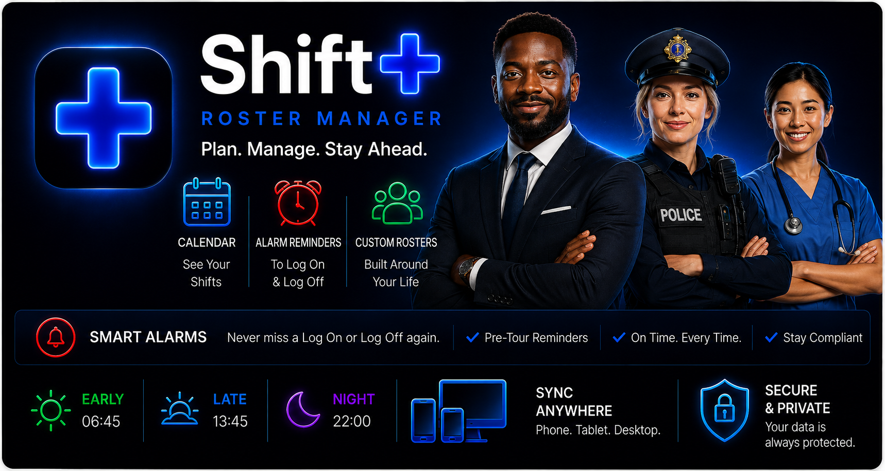
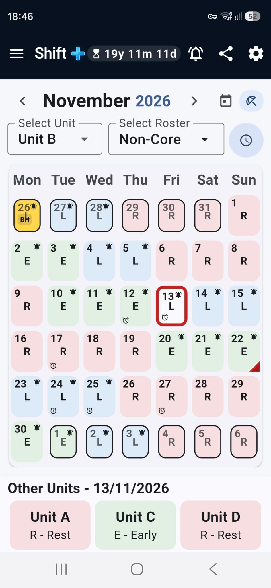
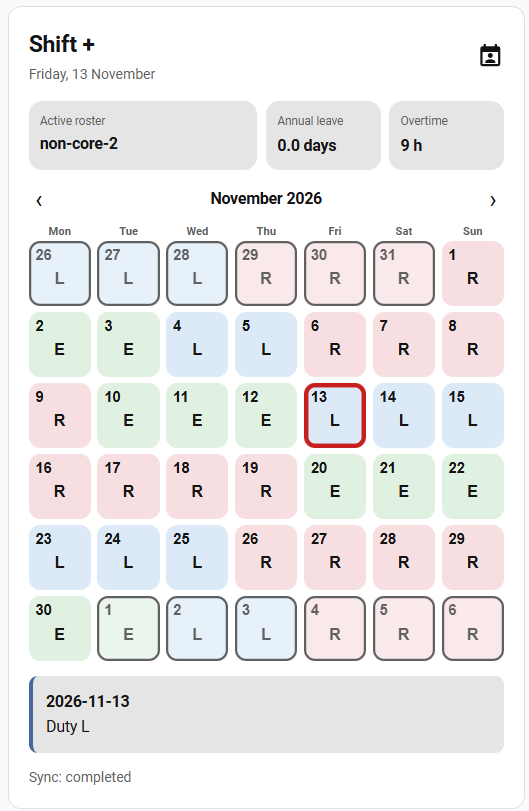
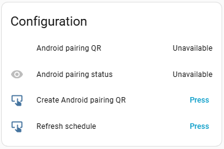
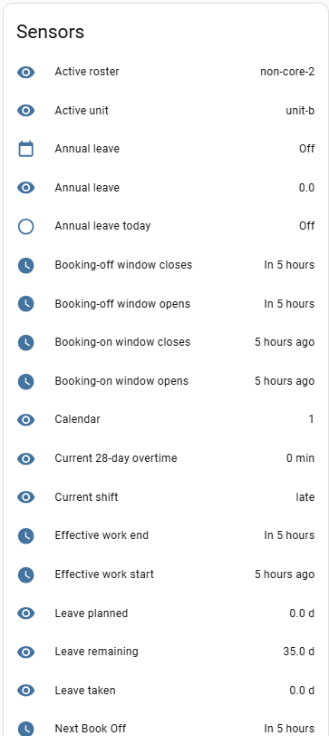
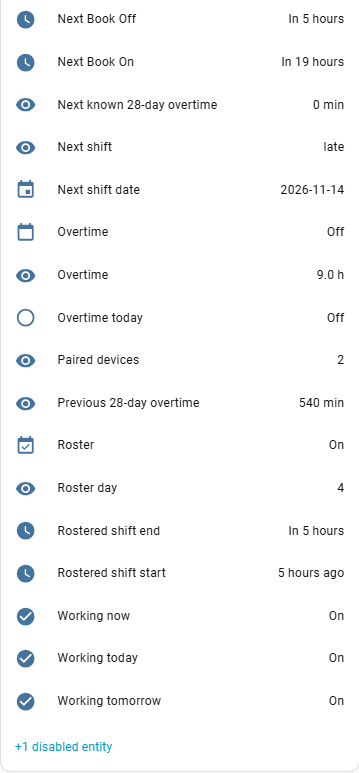

# Shift + for Home Assistant

<p align="center"></p>

<p align="center"><a href="https://www.shiftplus.plus/"></a></p>

<p align="center"><a href="https://www.shiftplus.plus/"><strong>Website</strong></a> &nbsp;•&nbsp; <a href="https://play.google.com/store/apps/details?id=ie.shiftplus.app"><strong>Get Shift + on Google Play</strong></a> &nbsp;•&nbsp; <a href="docs/installation.md"><strong>Home Assistant installation guide</strong></a></p>

**Shift +** brings the roster you manage in the Android app into Home Assistant. Pair once, let Android synchronize your active roster, annual leave and overtime, then see your schedule wherever Home Assistant is useful to you.

Shift + Premium is required for Android pairing and roster synchronization. Home Assistant stores a local synchronized copy and calculates its live schedule information locally. The public release is **v5.1.2**; this audit branch contains unreleased documentation and dashboard work and does not represent a published v5.1.3 release.

## Shift + Android app

Manage rosters, leave, overtime and work alarms in the genuine Shift + Android application. The calendar below shows the Android colour language used by the Home Assistant monthly card.

<p align="center"></p>

## Home Assistant monthly roster dashboard

The genuine Home Assistant dashboard card keeps the same easy-to-read duty colours, adds leave and overtime summaries, and lets you browse calculated historical and future months.

<p align="center"></p>

## Home Assistant integration

The integration adds pairing controls and schedule entities to the Shift + device. These genuine captures show the configuration controls and an example selection of populated entities; they do not purport to show every entity.

<p align="center">  </p>

## What you get

- Current and next duty, active roster and unit at a glance.
- Rostered and effective start/end times, including Book On and Book Off windows.
- Leave, overtime, working status and calendar entities for dashboards and automations.
- A responsive monthly roster card with Android-matched Early, Late, Night and Rest colours; annual-leave/overtime markers; and a current-day outline.
- Calculated historical and future month navigation without exposing pairing or entitlement data to the card.
- Secure Android pairing and ongoing synchronization.

## Install and pair

1. In Home Assistant 2026.11 or newer, open **Settings → Marketplace** and install **Shift +**. On older systems, find it under **HACS → Integrations**.
2. Open **Settings → Devices & services → Add integration**, then choose **Shift +**.
3. Create the Android pairing QR from the Shift + device and scan it in the Shift + Android app within five minutes.
4. Wait for the first sync, then add the optional monthly card to a dashboard.

```yaml
type: custom:shift-plus-roster-card
title: Shift + roster
calendar_entity: sensor.shift_calendar
roster_entity: sensor.shift_active_roster
status_entity: sensor.shift_paired_devices
leave_entity: sensor.shift_annual_leave
overtime_entity: sensor.shift_overtime
font_size: medium
calendar_cell_size: comfortable
layout_density: comfortable
```

For normal storage-mode dashboards, the integration registers the card resource automatically. You do not need to copy a `lovelace` folder, edit `.storage`, use a terminal or manually register JavaScript.

## Learn more and get help

- [Website](https://www.shiftplus.plus/)
- [Shift + on Google Play](https://play.google.com/store/apps/details?id=ie.shiftplus.app)
- [Beginner installation and pairing guide](docs/installation.md)
- [Monthly roster card and appearance guide](docs/dashboard.md)
- [Entity reference](docs/entities.md)
- [Security model](docs/security.md)
- [Report an issue](https://github.com/bgibbo/shift-plus-home-assistant/issues)

## Development

Contributor setup and validation commands are in [docs/development.md](docs/development.md). The project is maintained by **GIBBO** and licensed under the [MIT License](LICENSE).
